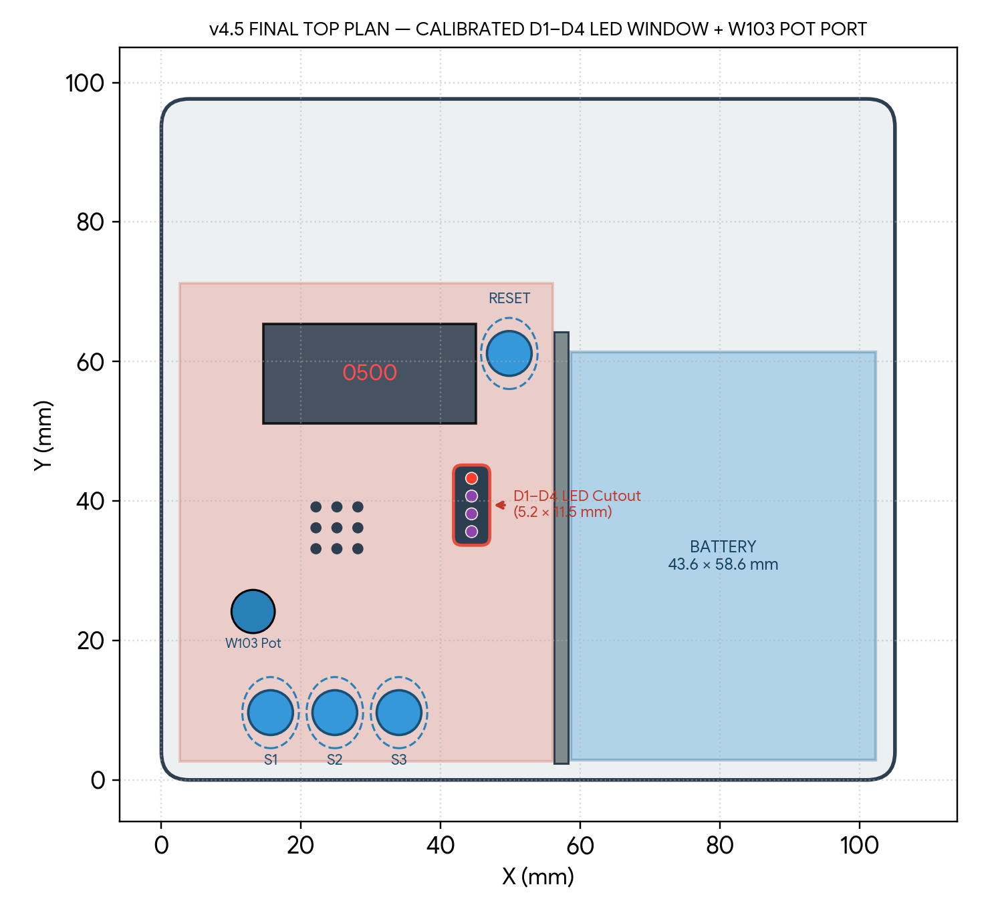
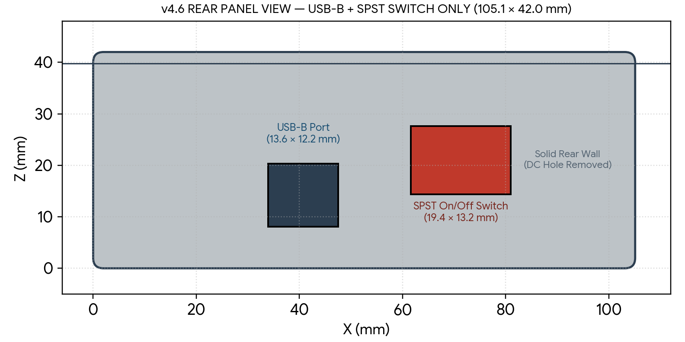

# Arduino Uno + HW-262 Multifunction Shield Enclosure (v4.6 Final)

[](https://bambulab.com)
[](https://openscad.org)
[]()
[](LICENSE)
[](https://tumesh007.github.io/arduino-multifunction-shield-case/)

## ⚡ Interactive Web Simulator (Kids & Makers Learning Mode)

Try the **Shivansh Timer v9.0** firmware and the hardware shield right inside your browser without uploading code to an Arduino!

👉 **[https://tumesh007.github.io/arduino-multifunction-shield-case/](https://tumesh007.github.io/arduino-multifunction-shield-case/)**

- **🧠 Simon Says (Mode 23):** Musical memory sequence game for kids with Web Audio tones.
- **⚡ Reaction Reflex Tester (Mode 21):** Measures reaction time in milliseconds from `GO` signal.
- **♟️ 2-Player Chess Clock (Mode 24):** Complete chess clock with customizable delays and increments.
- **⏱️ Stopwatch & Lap Stats (Mode 19):** High-precision timer with Best and Average lap views.
- **🔢 Tally Counter (Mode 20):** Up/down event counter.
- **🕒 Clock & 17 Countdown Timers (Modes 1–18):** 12H/24H clock and timers from 1 min to 3 hours with blinking alarm buzzer.

A compact, fully integrated, FDM-optimized two-piece enclosure housing an **Arduino Uno R3**, standard **HW-262 Multifunction Shield (MFS)**, and an **onboard battery pack**, engineered specifically for the 180 × 180 × 180 mm build plate of the **Bambu Lab A1 Mini** with **WOL3D Gold Textured PEI Plate**.





---

## 1. Specifications & Comparison

### v4.6 Final Enhancements (Clean Solid Rear Wall)
- **Clean Rear Wall Profile**: Removed unnecessary Ø 8.2 mm DC barrel jack hole. Right-hand rear service wall is now a solid, seamless continuous shell.
- **Retained Rear Service Cutouts**: Preserved standard 13.6 × 12.2 mm Arduino USB Type-B programming port cutout and 19.4 × 13.2 mm snap-in SPST rocker switch bezel.
- **Calibrated UI Apertures**: Retained verified v4.6 positions for D1–D4 status LEDs (39.20, 31.00 mm), W103 trimpot (10.50, 21.50 mm, Ø 6.20 mm), and 3×3 piezo buzzer acoustic vent grid.
- **Tactile Button Layout**: 9.20 mm button spacing (S1–S3) with RST at Y = 58.50 mm.
- **Reinforced 0.80 mm Living Hinges**: 4-layer flexures (0.80 mm) with 0.40 mm breakaway ties for zero jam risk.
- **3D Printed M3 Fasteners**: Complete parametric fastener set in stl/fasteners/.

| Specification | Sept 9 Design (v2) | v4.6 Final (Current) | Engineering Advantage |
|---|---|---|---|
| **Outer Dimensions (L × W × H)** | 117.60 × 98.40 × 46.60 mm | **105.10 × 97.65 × 42.00 mm** | **12.5 mm shorter, 4.6 mm lower** (~20% volume & filament savings) |
| **Buttons / Tactile Interface** | 3 separate loose plungers (S1–S3) | **4 integrated living-hinge flexures** (S1, S2, S3, RST) | Single-piece lid print. Zero drop/jam risk; adds direct Reset switch access |
| **Battery Retention** | Passive cavity wall | **Active cantilever snap-arm** (10 mm wide beam, 1.4 mm ramped hook) | Locks 9V battery securely; prevents rattling and dislodgement |
| **Microcontroller Mount** | Friction side rails | **4× Uno R3 PCB screw standoffs** (M2.5/M3 pilot holes) | Rigid mechanical fastening; eliminates PCB movement during button presses |
| **Rear Service Bay** | +7 mm manual offset patch | **Parametric 24 mm bay** (USB-B, 19.4×13.2 mm SPST switch, 8.2 mm DC jack) | Clean wire routing zone; clears 33 mm internal DC barrel jack body |
| **Wall Thickness** | 2.40 mm | **2.40 mm** (6 perimeter loops @ 0.4 mm nozzle) | High rigidity |

---

## 2. Bambu Lab A1 Mini Slicing & Print Profile

Both STL models in `stl/` are pre-oriented for immediate drop-and-print on the Bambu Lab A1 Mini. **Zero rotation and zero supports required.**

| Parameter | Setting | Rationale / Engineering Constraint |
|---|---|---|
| **Printer** | Bambu Lab A1 Mini (0.4 mm Nozzle) | Verified fit within 180 × 180 mm bed (Model: 105.1 × 97.7 mm) |
| **Build Plate** | WOL3D Gold Textured PEI Plate | Excellent first-layer adhesion; clean bottom texture |
| **Filament (Lid / Cover)** | **PETG** (Recommended) or Tough PLA | Living-hinge flexures undergo cyclic bending; PETG elongation prevents fatigue snap |
| **Filament (Base Housing)** | **PETG** or **PLA / PLA+** | High structural rigidity for screw bosses and snap latch |
| **Layer Height** | **0.20 mm Standard** | **MANDATORY.** Flexures are exactly 0.80 mm (4 layers); breakaway ties are 0.40 mm (2 layers) |
| **Initial Layer Height** | 0.20 mm | Matches flexure layer slicing multiples |
| **Wall Loops** | **6** | Produces 100% solid 2.4 mm shell walls and solid screw posts |
| **Top Shell Layers** | 5 (1.0 mm) | Prevents pillowing over sparse infill |
| **Bottom Shell Layers** | 5 (1.0 mm) | Rigid solid floor |
| **Sparse Infill Density** | 20% | Optimal stiffness-to-weight ratio |
| **Sparse Infill Pattern** | Gyroid | Isotropic shear and compressive strength |
| **Supports** | **DISABLED (None)** | Designed 100% self-supporting (chamfered plungers, bridged cutouts) |
| **Brim** | Base: 4–5 mm outer brim; Lid: None | Prevents corner lifting of deep base box on textured PEI |
| **First Layer Speed** | 30 mm/s | Ensures precise extrusion around living-hinge perimeter micro-slots |

### Print Orientations

- **Base Housing (`stl/bottom_housing.stl`):** Place floor flat on bed (open top facing +Z).
- **Front Plate (`stl/front_plate_integrated_buttons.stl`):** Pre-oriented face-down on bed (outer cosmetic face at Z = 0; plunger stems point vertically upward into +Z).

---

## 3. Post-Print Processing & Assembly Instructions

1. **Freeing the Integrated Living-Hinge Buttons:**
   - Each button cap on the front plate includes two 0.40 mm sacrificial breakaway stabilizer ties (`btn_sacrificial_tie`) along the X-axis.
   - Use a sharp craft blade (X-Acto or scalpel) to slice through the two breakaway ties flanking each button.
   - Depress each button 2–3 times with your thumb to seat the dual serpentine flexures. Tactile button travel is 0.65 mm.
2. **Mounting the Hardware:**
   - Fasten the Arduino Uno R3 onto the 4 lower standoffs using 4× M2.5 or M3 thread-forming screws (6–8 mm length).
   - Seat the HW-262 Multifunction Shield onto the Uno R3 header pins.
   - Insert the panel-mount SPST rocker switch (19.4 × 13.2 mm cutout) and 5.5×2.1 mm DC barrel jack (8.2 mm hole) in the rear service panel.
   - Connect battery and power switch leads in the rear service bay.
3. **Inserting Battery:**
   - Slide the battery pack into the battery compartment.
   - The cantilever snap arm flexes backward and clicks over the top shoulder of the battery at Z = 32.3 mm.
4. **Lid Closure:**
   - Lower the front plate onto the base housing. The 1.1 mm stepped mating lip aligns the perimeter.
   - Fasten with 4× M3 countersunk screws (12–16 mm length) into the corner screw bosses.

---

## 4. Repository Structure

```
.
├── config.scad             # Central parametric configuration and geometric assertions (v4.6)
├── main.scad               # Top-level assembly and STL export entrypoint (v4.6)
├── internals.scad          # Uno standoffs, battery divider, and cantilever snap-arm
├── buttons.scad            # Stadium-flexure living hinge integrated button plungers
├── cutouts.scad            # Rear panel I/O (USB, SPST, DC jack) and top display windows
├── utilities.scad          # Geometric helper modules
├── stl/
│   ├── bottom_housing.stl                  # v4.6 base enclosure STL (manifold, pre-oriented)
│   ├── front_plate_integrated_buttons.stl  # v4.6 lid STL with living-hinge buttons (pre-oriented)
│   ├── complete_assembly.stl               # v4.6 full mated assembly preview STL
│   └── fasteners/
│       ├── M3_12mm_Countersunk_Corner_Screw.stl
│       ├── M3_8mm_Socket_Cap_Uno_Mount_Screw.stl
│       └── M3_Hex_Nut.stl
├── docs/
│   ├── BAMBU_A1_MINI_PRINT_GUIDE.md        # Comprehensive slicing profile and post-processing guide
│   ├── top_plan_v4_4_final.png                   # Dimensioned plan view diagram
│   ├── MASTER_PROMPT_REV_5.md              # Engineering constraint log
│   └── HANDOFF.txt                         # Hardware dimension verification records
├── legacy_v2_sept09/       # September 9 version (loose plunger plungers, 117.6 x 98.4 mm)
├── legacy_v1_modular/      # July 2026 15-module precursor architecture
├── blender/
│   └── project.blend       # 3D visualization mockups
├── firmware/
│   └── ShivanshTimer_v9/
│       ├── ShivanshTimer_v9.ino            # Shivansh Timer v9.0 Arduino Uno + MFS firmware (24 modes)
│       └── README.md                       # Comprehensive firmware user manual & control reference
├── tools/                  # FreeCAD and Python geometric audit suite
├── LICENSE                 # CC BY-NC-SA 4.0
└── .gitignore
```

---

## 5. Bill of Materials (BOM)

| Item | Component | Notes |
|---|---|---|
| **MCU** | Arduino Uno R3 | Standard footprint (53.4 × 68.6 mm) |
| **Shield** | HW-262 / MFS Multifunction Shield | 4-digit 7-segment display, S1–S3 + RST buttons, pot, buzzer |
| **Battery** | 9V Battery Pack | Maximum envelope: 43.6 × 58.6 × 29.9 mm |
| **Power Switch** | SPST Rocker Switch | Snap-in bezel: 19.4 × 13.2 mm |
| **DC Connector**| Internal DC Barrel Jack | Wired internally; external hole removed in v4.6 |
| **Fasteners (PCB)** | 4× M2.5 or M3 × 6–8 mm screws | Self-tapping into 2.75 mm standoff pilot holes |
| **Fasteners (Case)**| 4× M3 × 12–16 mm countersunk screws| Fastens lid into corner screw bosses |

---

## 6. Firmware: Shivansh Timer v9.0

The enclosure houses an Arduino Uno running the **Shivansh Timer v9.0** sketch located in [`firmware/ShivanshTimer_v9/`](firmware/ShivanshTimer_v9/):

- **24 Operating Modes:** Clock (RTC / uptime fallback), 17 Countdown Presets (1 min to 3 hr), Stopwatch with lap averaging, Tally Counter, Reaction Timer, Interval Training Timer, Simon Says memory game, and Configurable 2-Player Chess Clock.
- **Hardware Integration:** Direct mapping to the HW-262 shield's 4-digit 7-segment display, S1–S3 living-hinge buttons, Reset button, piezo buzzer acoustic alerts (with silent mode toggle), and D1–D4 status LEDs.
- **EEPROM State Retention:** Saves brightness, silent mode, last chess preset, alarm configuration, and session restore across power cycles.

See [`firmware/ShivanshTimer_v9/README.md`](firmware/ShivanshTimer_v9/README.md) for the complete user manual and controls guide.

---

## 7. License

Licensed under [Creative Commons Attribution-NonCommercial-ShareAlike 4.0 International (CC BY-NC-SA 4.0)](LICENSE).
